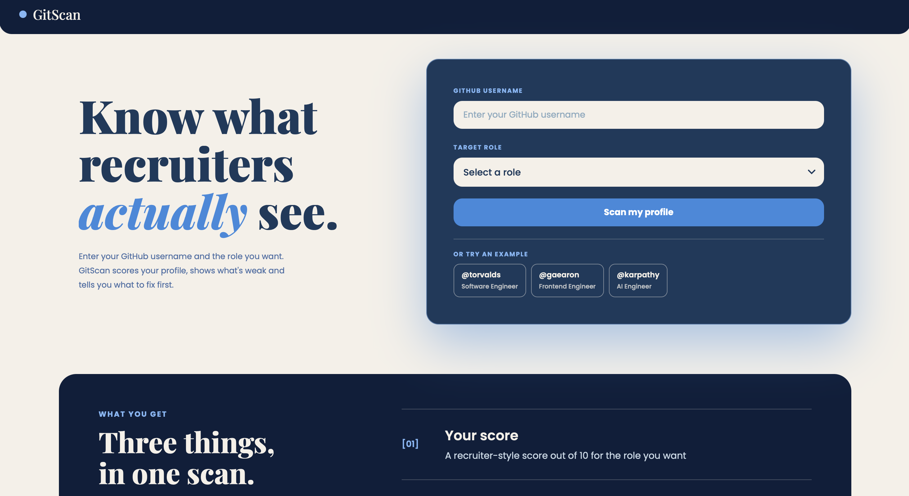
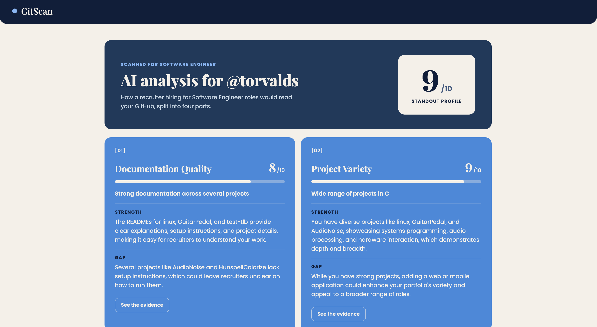
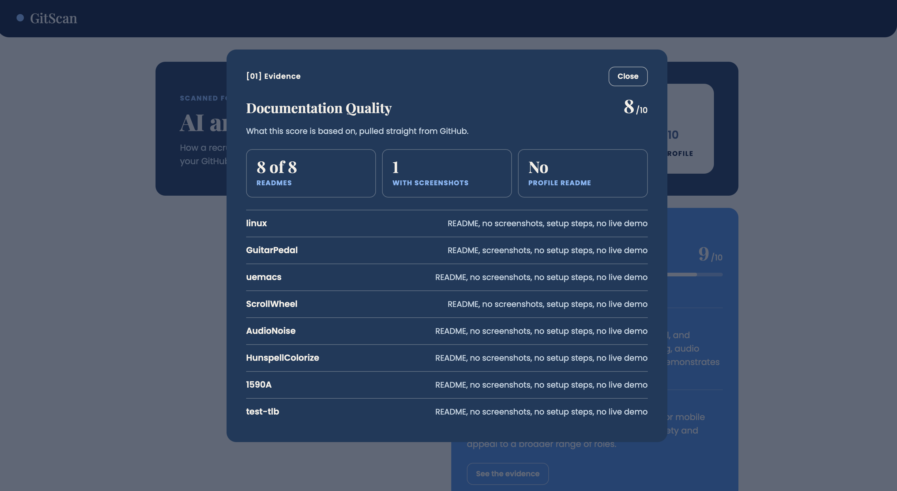

# GitScan

**See your GitHub the way a recruiter does.** GitScan scores any public GitHub profile for a chosen role, shows the evidence behind every score, and gives you a prioritized plan to improve it.

**Live demo: [git-scan-lake.vercel.app](https://git-scan-lake.vercel.app)** · Try it with `torvalds`, `gaearon` or `karpathy`, no sign-up needed.



---

## What it does

1. **Pick a username and a target role**, from Frontend Engineer to AI Engineer (12 roles).
2. **GitScan reads the profile** like a recruiter skims it: repos, READMEs, languages and a year of contributions.
3. **You get a score out of 10** across four categories, each with a one-line verdict, a strength and a gap.
4. **Click any card** to flip it and see the evidence: the exact facts from GitHub that the score is based on.
5. **An action plan** lists what to fix, most important first, and you can tick items off as you go.

| Score and category cards | Evidence on the back of each card |
|---|---|
|  |  |

---

## How it works: facts in code, judgment from AI

The core design decision: **anything countable is calculated in code, and the AI only does what code can't**, which is reading READMEs and writing feedback. This keeps scores consistent, explainable and hard to inflate.

```
GitHub API  →  Fact check (code)  →  LLM review (AI)  →  Guardrails (code)  →  24h cache
```

| Step | What happens |
|---|---|
| **GitHub API** | The backend fetches the profile, up to 15 original repos, README content for the 8 most recent, and a year of contributions (REST + GraphQL). |
| **Fact check (code)** | Code works out the experience level, the exact Activity score, score ceilings for the other categories, and a README facts list for each repo. |
| **LLM review (AI)** | The model gets the profile data, the role's hiring criteria, calibration examples and the facts list, and returns structured JSON: verdicts, strengths, gaps and an action plan. |
| **Guardrails (code)** | Scores are clamped to the code-set limits, made-up repo names are dropped, and the overall score is a weighted average calculated in code (Documentation 20%, Variety 25%, Activity 25%, Role relevance 30%). |
| **Cache** | Results are kept for 24 hours, so repeat scans load instantly and cost nothing. |

Other details:

- **Evidence is built in code**, never by the AI, so the back of each card can't be made up.
- **Prompt injection protection:** README text is treated as data, and instructions inside it are ignored.
- **Rate limiting and input validation** on the API, and the OpenAI key never reaches the browser.

---

## Evaluation

I wrote an evaluation script ([`backend/eval/run-eval.js`](backend/eval/run-eval.js)) that runs GitScan on 10 profile and role pairs, from beginner accounts to well-known engineers, **3 times each**, and checks the output automatically:

- **Consistency:** do the 3 runs agree within 1 point?
- **Calibration:** does each profile land in its expected range, with elite above intermediate above beginner?
- **Style:** no banned filler phrases, no em dashes, word limits followed
- **Accuracy:** does the AI ever contradict the GitHub data, for example claiming a README has setup steps when it doesn't?

I used it to tune the prompt and the scoring code over three rounds:

| | Round 1 | Round 2 | Round 3 |
|---|---|---|---|
| Consistent across 3 runs | 10 of 10 | 10 of 10 | 10 of 10 |
| Banned-phrase issues (30 runs) | 13 | 18 | **8** |
| Contradictions with GitHub data (30 runs) | 21 | 21 | **15** |
| Score for an inactive one-repo account | 5 / 10 | **3 / 10** | 3 / 10 |

**What changed between rounds:**
- **Round 2:** moved the Activity score and per-category score ceilings into code, and fixed the experience-level rules. Thin profiles stopped being scored like active ones.
- **Round 3:** added a code-generated README facts list and a final rules checklist at the end of the prompt.

**What it found:** most of the remaining contradictions trace back to my setup-step detection, which misses build instructions like `make` in C projects. So the evaluation surfaced a weakness in the data pipeline, not only in the prompt.

**Performance:** about 7.6 seconds and about $0.001 per scan.

---

## Tech stack

| Part | Tools |
|---|---|
| **Frontend** | React, React Router, Framer Motion, plain CSS (no UI library) · deployed on Vercel |
| **Backend** | Node.js, Express, express-rate-limit · deployed on Railway |
| **Data** | GitHub REST and GraphQL APIs (authenticated) |
| **AI** | OpenAI Chat Completions with JSON output, low temperature for consistency |

---

## Running it locally

**Backend**

```bash
cd backend
npm install
```

Create `backend/.env`:

```
OPENAI_API_KEY=your_openai_key
GITHUB_TOKEN=your_github_token
OPENAI_MODEL=gpt-4o-mini
PORT=5001
```

```bash
npm run dev
```

**Frontend** (in the project root, in a second terminal)

Create `.env` in the project root:

```
REACT_APP_API_URL=http://localhost:5001
```

```bash
npm install
npm start
```

**Evaluation**

```bash
cd backend
EVAL_MODE=true npm run dev     # terminal 1: turns off the cache and rate limit
node eval/run-eval.js          # terminal 2
```

---

## Project structure

```
backend/
  app.js            API route, validation, rate limiting, cache
  github.js         GitHub REST + GraphQL data fetching
  prompt.js         Prompt, experience level, score limits, guardrails
  evidence.js       Builds the evidence shown on the back of each card
  eval/run-eval.js  Evaluation script

src/components/
  Home              Landing page and scan form
  ProfilePage       Profile overview, languages and repos
  ScorePage         Results page
  ScoreCards        Flip-and-expand category cards with evidence
  LoadingScreen     Animated scanning screen
  ActionPage        Action plan checklist
  Reveal            Reusable scroll-reveal animation
```

---

## Limitations

- Only **public, personal** repos are analyzed. Work inside organizations (for example a company's React repo) isn't counted, so some well-known engineers score lower than their reputation.
- READMEs are read for the 8 most recently updated repos only.
- Setup-step detection uses pattern matching and misses some build instructions.
- Scores can still vary by a point between runs, since the written feedback comes from an AI model.
- The cache is in memory, so it resets when the server restarts.

---

## Privacy

GitScan only reads public GitHub data. It's sent to OpenAI to generate the analysis. Results are kept on the server for 24 hours so repeat scans load instantly, and a copy is saved in your own browser.

---

## Built by

**Sara Deshpande** · [GitHub](https://github.com/sara-deshpande)